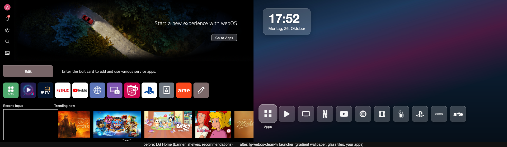

# lg-webos-clean-tv

A clean LG webOS TV: **your own minimal Home screen** (wallpaper, clock, one row of apps), **no ad banner, no sponsored rows,
no "Live on LG Channels"**, **LG ad / telemetry / ACR hosts blocked**, promotions switched off. Reversible in one command.

Tested end to end on an **LG OLED77C37LA (C3, 2023), webOS 11.2.0-3701 ("webOS 26"), October 2026**, rooted with Homebrew Channel.
Other models and firmware versions will differ. Read the whole page before you start.




## What you get

| Before | After |
|---|---|
| Hero banner ("Start a new experience with webOS"), Edit card, app row, Recent input, "Live on LG Channels", "Trending now", sponsored rows | Wallpaper, a glass clock, one app row with exactly the apps you want |
| Ad, telemetry and ACR beacons to lgsmartad.com, cdpbeacon.lgtvcommon.com, … | Blocked in `/etc/hosts` at every boot |
| Home promotion, Live promotion, LG Channels auto start, UI transparency | Off via LG's own settings service (persist, no hacks) |

Nothing on the read-only system partitions is modified. Everything lives in `/var/lib/webosbrew/cleantv` and is applied at boot by
two Homebrew Channel init.d hooks. `uninstall.sh` puts LG's Home back.

## The whole path, in order

| # | Step | Where |
|---|---|---|
| 0 | Check rootability, root the TV, Homebrew Channel: Root status ok, **Block system updates**, **SSH server** on, SSH key | [docs/STEP-0-HOMEBREW-SSH.md](docs/STEP-0-HOMEBREW-SSH.md) |
| 1 | Copy this repo to the TV and run `tv/install.sh` — hooks, settings switches, ad/telemetry block, launcher active immediately | *Install* below |
| 2 | Edit `config/hidden_apps.txt`, `config/order.txt`, optional `config/remove_apps.txt`; run `order.sh` | *Customize* below |
| 3 | Replace `launcher/wallpaper.jpg`, adjust `index.html` if you like | *Customize* below |
| 4 | Reboot once and watch: last input at ~13 s, launcher at ~26 s | *Boot behaviour* below |
| 5 | Optional: IPTV player, why not Kodi on webOS 26 | [docs/IPTV.md](docs/IPTV.md) |
| 6 | If anything looks wrong: rollback in one command, read the boot log | *Rollback*, [docs/TROUBLESHOOTING.md](docs/TROUBLESHOOTING.md) |

## Requirements

1. A **rooted** LG webOS TV with **Homebrew Channel** and **SSH** enabled. Root instructions and the "can I root my TV" table live at
   [cani.rootmy.tv](https://cani.rootmy.tv) and [webosbrew.org](https://www.webosbrew.org). For 2023–2026 firmware the working
   userspace exploit at the time of writing was [throwaway96/slopbro](https://github.com/throwaway96/slopbro).
2. In Homebrew Channel: **Block system updates** on (an LG update would otherwise remove root), **SSH server** on.
3. A computer with `ssh`/`scp`. Default root password of Homebrew Channel's SSH server is `alpine` — change it or use a key.
4. `/usr/bin/node` on the TV (present on webOS 5+; used to copy app icons).

**Not rooted yet?** Start with [docs/STEP-0-HOMEBREW-SSH.md](docs/STEP-0-HOMEBREW-SSH.md): where the root methods are documented, Homebrew Channel settings, SSH keys, installing IPKs, and the ares-cli traps.

## Install (10 minutes)

```bash
# on your computer, from this repository
scp -r . root@<tv-ip>:/tmp/cleantv
ssh root@<tv-ip> 'sh /tmp/cleantv/tv/install.sh'
```

`install.sh` copies scripts and config to `/var/lib/webosbrew/cleantv`, installs the two boot hooks, switches the LG promotions off,
blocks the ad hosts for this boot, and activates the launcher **immediately, without rebooting or restarting any LG service**.
Press **Home**: you should see the new launcher.

Then customize (all on the TV, as root):

| What | Where |
|---|---|
| Wallpaper | replace `/var/lib/webosbrew/cleantv/launcher/wallpaper.jpg` (1920×1080 JPEG), press Home twice |
| Hide tiles | edit `/var/lib/webosbrew/cleantv/config/hidden_apps.txt`, run `sh /var/lib/webosbrew/cleantv/bin/order.sh` |
| Row order | edit `/var/lib/webosbrew/cleantv/config/order.txt`, run `order.sh` |
| Remove store preloads at boot | `config/remove_apps.txt` (removable apps only) |
| Ad hosts | `config/adblock-hosts` (one `0.0.0.0 host` per line) |
| Look & feel | `launcher/index.html` (plain HTML/CSS/JS, no build step) |

Find app ids with `luna-send -n 1 -f luna://com.webos.service.homelaunchpoints/listLaunchPoints '{}'`.

## Rollback

```bash
ssh root@<tv-ip> 'sh /var/lib/webosbrew/cleantv/bin/rollback-home.sh --permanent'   # LG Home back, hook off
ssh root@<tv-ip> 'sh /tmp/cleantv/tv/uninstall.sh'                                   # everything off, tiles unhidden
```

Both work at runtime, no reboot needed. Tiles hidden with `hideLaunchPoint` stay hidden in LG's Home too until you run `uninstall.sh` (it unhides them) or `unhideLaunchPoint` yourself. The settings switches (`settings.sh`) are LG's own settings; turn them back on in the TV menu if you miss them.

## How it works (short)

- LG's Home (`com.webos.app.home`) is a Flutter app on webOS 10/11. Its layout XML can be bind-mounted, but it cannot show a wallpaper or clock,
  so the launcher here is a **separate web app bind-mounted over LG Home's directory with LG Home's app id**. It inherits Home's
  permissions, the Home button opens it, and LG's own Home never draws.
- The app manager (SAM) caches `appinfo.json` at boot. Instead of restarting SAM (which on this firmware ends in a black screen, see
  troubleshooting) the hook makes SAM **re-read exactly this one manifest** with `blockSystemApp` + `releaseBlockSystemApp`. That trick comes
  from [rorygallagher2024/glasshouse](https://github.com/rorygallagher2024/glasshouse) (`lib/samrescan.js`, `lib/home-takeover.js`),
  also used by [ecklf/lg-luma](https://github.com/ecklf/lg-luma).
- Tiles are hidden with the official `homelaunchpoints/hideLaunchPoint`; order with `moveLaunchPoint`. Both are reversible.
- Icons: the web app may not load `file://` icons from other app folders, so `refresh.sh` copies them into the launcher folder.

Optional IPTV step: [docs/IPTV.md](docs/IPTV.md). Details: [docs/HOW-IT-WORKS.md](docs/HOW-IT-WORKS.md). Things that went wrong and why: [docs/TROUBLESHOOTING.md](docs/TROUBLESHOOTING.md).

## Boot behaviour

bootd puts your last input (e.g. HDMI) on screen at ~13 s. Homebrew Channel starts its hooks at ~22 s; the launcher becomes Home
at ~26 s and is opened automatically. There is no earlier hook point from user space, and LG's "Home auto launch" is disabled in this
model's device profile, so the ~13 s of HDMI/last input before the launcher cannot be avoided.

## Not included on purpose

- No IPTV provider, playlist or credentials. For IPTV on webOS see the open-source
  [lennylxx/webos-iptv-player](https://github.com/lennylxx/webos-iptv-player) (Xtream, M3U, EPG, movies, series, credentials stay on the TV).
- No disabling of system services at boot (`systemctl stop …` from a hook left this TV with a black screen once; runtime-only if you must).
- No third-party wallpaper artwork; the default is a generated gradient.

## Credits

Glasshouse (SAM re-read, home takeover), lg-luma (home.sh pattern), webosbrew.org (Homebrew Channel, init.d hooks),
furkan-bayrak/lg-tv-blocklist (ad/telemetry host list, "safe" tier), throwaway96 (SlopBro).

## License

MIT. Use at your own risk; this modifies a rooted TV.
